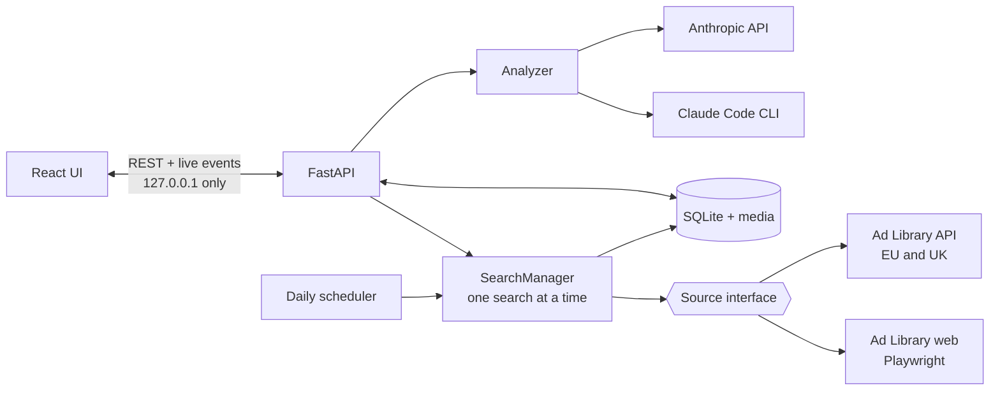

<div align="center">

# AdScout

**Is this product a proven winner? Ask the ads.**

AdScout reads the public Meta Ad Library for a product, scores it against a winner's bar you can
see and check, and has Claude find the selling angles. It runs on your own machine.

[](https://github.com/SmitHunter/adscout/actions/workflows/ci.yml)
[](LICENSE)
[](https://www.python.org/downloads/)
[](https://nodejs.org/)

[Quick start](#quick-start) · [How the score works](#how-the-score-works) · [Engineering](#engineering) · [FAQ](#faq)

</div>


## Why

Dropshippers validate products by hand: search the Ad Library, scroll, and eyeball how long
ads have run and how many creatives exist. A product is likely a winner when advertisers
**keep paying** to run it, **keep making new ads** for it, and **sell it more than one way**.
AdScout does that scroll for you and turns it into four checks:

| Factor | What it measures | Fail | Pass | Full | Weight |
| --- | --- | ---: | ---: | ---: | ---: |
| **Longevity** | Age of the oldest active ad, in days | 30 | 90 | 180 | 30 |
| **Creative volume** | Distinct creatives, after grouping duplicates | 3 | 10 | 20 | 25 |
| **Angle diversity** | Selling angles Claude finds in the copy | 2 | 3 | 5 | 25 |
| **Continuity** | Months of the last 6 with a new creative | 3 | 5 | 5 | 20 |

Every factor is drawn as a ruler with its marks and the points it earned, so you can
disagree with the score and see exactly why.


## Quick start

You need [uv](https://docs.astral.sh/uv/) (it installs Python 3.12) and Node 22.22+.

```sh
uv sync
npm --prefix web ci && npm --prefix web run build
uv run adscout
```

The app opens at <http://127.0.0.1:8787>.

- **Try it without touching Meta:** `uv run adscout demo` opens a separate copy filled with
  invented products and advertisers. Searches and Claude calls are switched off.
- **For live searches:** run `uv run playwright install chromium` once.
- **For angle analysis:** sign in to [Claude Code](https://claude.com/claude-code), or put an
  `ANTHROPIC_API_KEY` in `.env` (copy it from `.env.example`).

## Features

- **Live search.** Keyword, country, active or all ads. Progress streams as it scrolls, you
  can cancel at any point, and every search is saved as a snapshot.
- **Winner Score.** Scored on the strongest advertiser, with the whole market shown beside it
  as "Market demand". Off-topic ads are left out, and you can move any ad back in or out.
- **Claude angle analysis.** Angles, hooks, offers, seasonality and a short verdict. Uses your
  Claude Code subscription or your API key, cached so the same ads are never paid for twice.
- **Creative gallery.** Images and videos saved locally (Meta's links expire), sortable by
  days running, with a launch timeline.
- **Watchlist.** Daily re-checks with trend charts, and an alert when active ads move 30% or more.
- **Compare and export.** Up to 4 products side by side. CSV, a one-page PDF, or a PNG to share.
- **CLI.** `scrape`, `report`, `analyze`, `exclude`, `watch` and more: `uv run adscout --help`.

| | |
| --- | --- |
|  |  |
|  |  |

## How the score works

Below a factor's fail mark it earns nothing. Between fail and pass it climbs from 30% to 70%
of its points, and from pass to full marks it climbs to 100%. Longevity also blends in the
share of creatives running 90 days or more, and Continuity reaches 100% at its pass mark.

Only relevant ads count: ads whose copy, title or link contains the keyword, plus anything you
include by hand, minus ads Claude flags as not selling the product. Until Claude has read the
ads, the score is built from the other three factors and marked **provisional**.

Full details: [docs/scoring.md](docs/scoring.md).

## Engineering



| | |
| --- | --- |
| **Backend** | Python 3.12, FastAPI, SQLModel + SQLite, Playwright, APScheduler, Typer |
| **Frontend** | React 19, TypeScript (strict), Vite, Tailwind CSS v4, TanStack Query, Recharts |
| **AI** | Anthropic SDK structured outputs, or Claude Code in headless mode |
| **Quality** | 945 tests (pytest + Vitest), mypy, Ruff, ESLint, CI on Linux, macOS and Windows, gitleaks |

What's worth a look:

- **The scraper is isolated.** Every ad source sits behind one `Source` interface, and the parser
  is tested against recorded Ad Library pages. When Meta changes its page, one module breaks
  and the tests show what changed.
- **Duplicate ads are grouped into creatives** by Meta's own grouping, matching copy and media,
  and perceptual image hashing.
- **Claude costs are controlled.** Results are cached per snapshot and reused across daily checks
  while 90% of creatives are unchanged. Automatic analysis is off by default and capped at 5 a day.
- **It's safe to leave running.** It answers only on loopback and blocks cross-site requests.
  Keys never reach logs or the UI. Ad copy is escaped so it can't inject instructions into the
  Claude prompt.
- **The API contract is typed end to end.** The server's OpenAPI schema generates the TypeScript
  types, and CI fails if the committed schema falls out of date.

[docs/architecture.md](docs/architecture.md) follows one search from click to score.

## Configuration

AdScout works with no configuration. The **Settings** screen covers the model, the daily check
time, auto-analysis, search limits and notifications.

<details>
<summary>Environment variables (<code>.env</code>)</summary>

| Variable | Default | What it does |
| --- | --- | --- |
| `ANTHROPIC_API_KEY` | unset | Use the Anthropic API for angle analysis. Without it, AdScout uses Claude Code. |
| `META_ACCESS_TOKEN` | unset | Search the EU and UK through the official Ad Library API. |
| `TIMEZONE` | `Australia/Melbourne` | Timezone for report dates and the daily check. |
| `HEADLESS` | `false` | Hide the scraper's browser window. |
| `DATA_DIR` | `data` | Where the database, media and browser profile live. |

Values saved on the Settings screen (`data/settings.json`) take priority over `.env`.

</details>

## FAQ

<details>
<summary><b>Does it need a Facebook login?</b></summary>

No. Searches run logged out in AdScout's own browser profile. If Meta asks for a login or a
security check, the search stops and tells you. Click **Open browser** in the app, complete
the check yourself, and search again.
</details>

<details>
<summary><b>Does it cost money?</b></summary>

AdScout is free and the Ad Library is public. Angle analysis is optional: Claude Code uses your
subscription's quota, and the API is billed to your key. See the cost controls under
[Engineering](#engineering).
</details>

<details>
<summary><b>Does the watchlist run when AdScout is closed?</b></summary>

No. The daily check runs while `uv run adscout` is running. If the app was closed at check time,
it catches up when you next start it, as long as that's within 24 hours.
</details>

<details>
<summary><b>How long does a search take?</b></summary>

A first search of 300 ads can take several minutes, mostly downloading media. Repeat checks
reuse media already on disk.
</details>

<details>
<summary><b>Windows, macOS or Linux?</b></summary>

All three. On Windows, use the native Claude Code installer: the npm-installed `claude.cmd`
can't take the JSON schema AdScout passes.
</details>

<details>
<summary><b>What are the known limitations?</b></summary>

- Meta changes its pages. The parser tests show the break in one module
  ([tests/fixtures/meta_web](tests/fixtures/meta_web) holds public Ad Library pages kept only for those tests).
- The official API covers EU and UK keyword searches only. Every other search uses the web source.
- Keyword relevance is literal. Use include and exclude for products sold under other names.
- The Claude Code backend ignores your own Claude Code settings, hooks and plugins.
</details>

## Disclaimer

AdScout is a personal research tool. It uses only publicly visible Meta Ad Library data, respects Meta's Terms, and is low-volume by design: one search at a time, randomised delays, a hard result cap, and it never bypasses logins or CAPTCHAs. You are responsible for how you use it.

AdScout is not affiliated with or endorsed by Meta or Anthropic.

## Contributing

Issues and pull requests are welcome. See [CONTRIBUTING.md](CONTRIBUTING.md), report security
issues as described in [SECURITY.md](SECURITY.md), and see [CHANGELOG.md](CHANGELOG.md) for changes.
Next on the roadmap: TikTok Creative Center as a second source.

## Built with Claude Code

Designed and built with [Claude Code](https://claude.com/claude-code), milestone by milestone,
from [one brief](docs/build-prompt.md). The plan for each milestone is in [docs/plans](docs/plans).

[MIT](LICENSE) © 2026 SmitHunter
