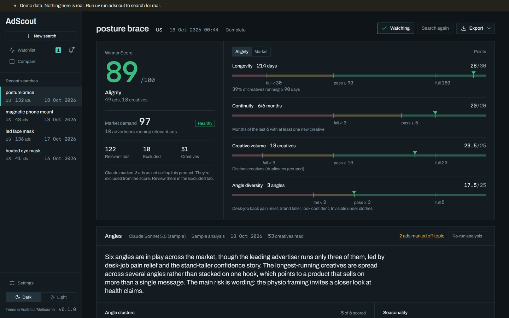
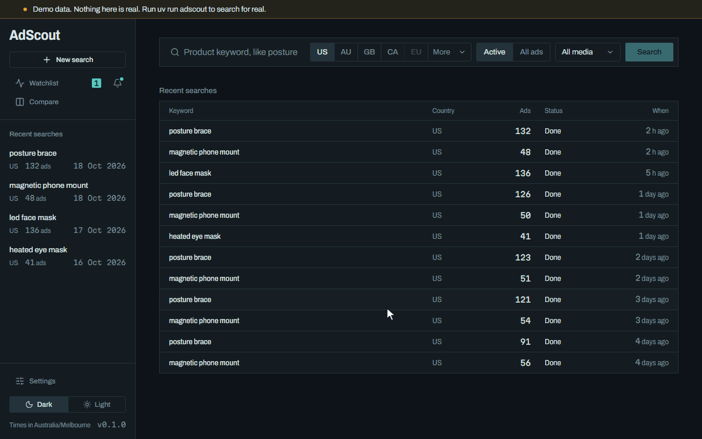
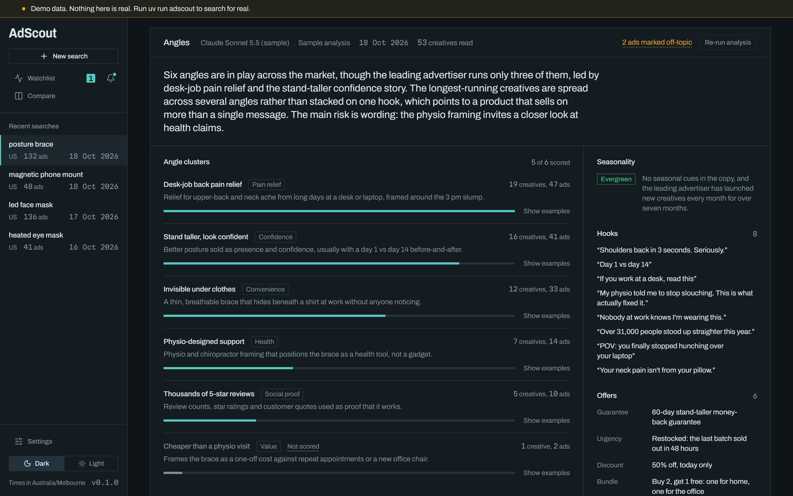
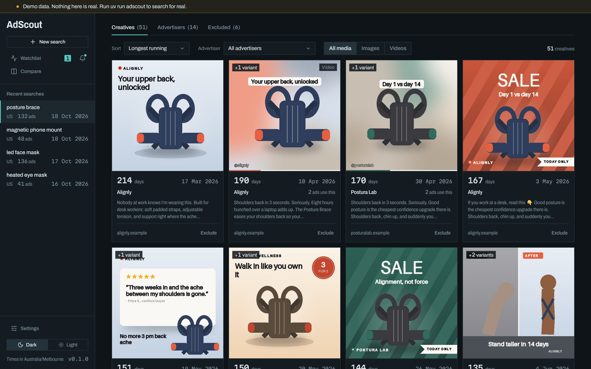
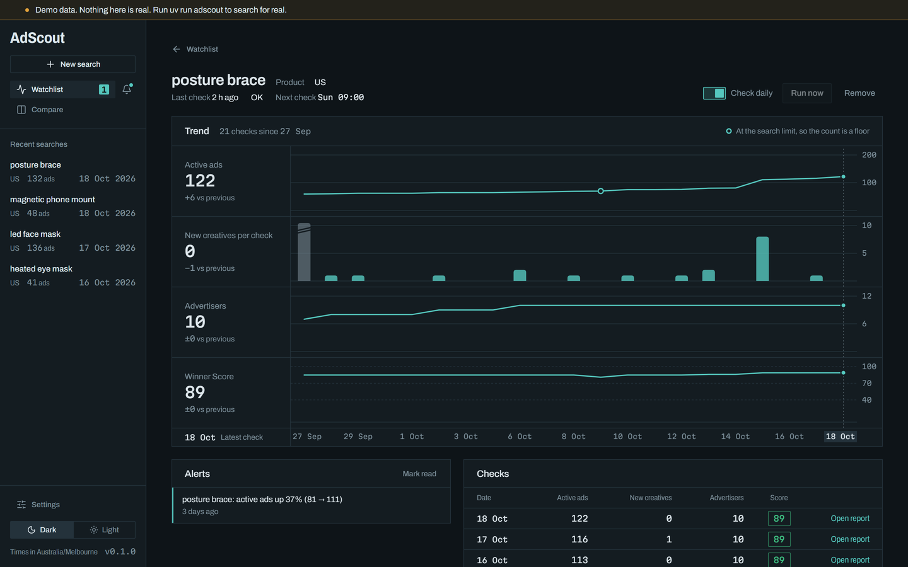
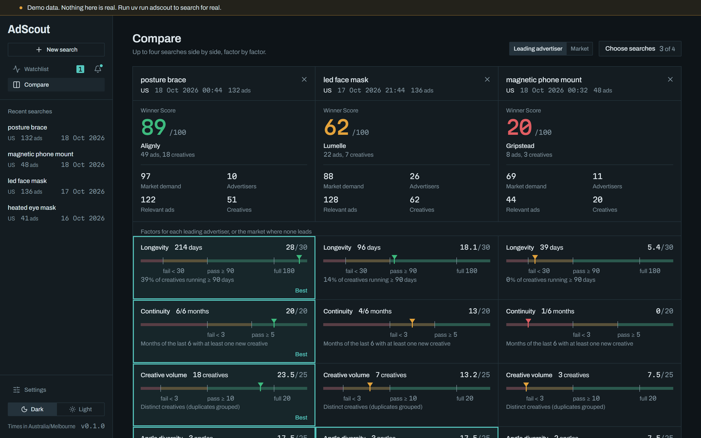
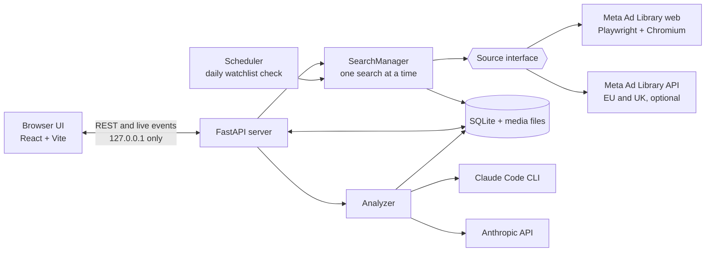

# AdScout

Find out if a dropshipping product is a proven winner — from public Meta Ad Library data, on your own machine.

[](https://github.com/SmitHunter/adscout/actions/workflows/ci.yml)
[](LICENSE)
[](https://www.python.org/downloads/)
[](https://nodejs.org/)



You type a product keyword. AdScout scrolls the public Meta Ad Library the way you would,
saves every ad it finds, groups duplicates into distinct creatives, and scores the product
against a winner's bar you can see and check. Claude reads the ad copy to find the selling
angles. Watch a product and AdScout re-checks it every day and tells you when its ad count
jumps.

Everything runs on your computer. There is no account, no cloud service and no tracking.

## What it tells you

A product is a likely winner when advertisers keep paying to run it, keep making new ads
for it, and sell it more than one way. AdScout turns that into four checks:

| The bar | How AdScout checks it |
| --- | --- |
| Ads running **3–6 months** | **Longevity:** age of the oldest ad that is still active (passes at 90 days, full marks at 180), blended with the share of creatives running 90 days or more. |
| **10+ distinct creatives** | **Creative volume:** ads grouped into creatives by Meta's own "N ads use this creative" grouping, matching copy and media, and image similarity. Passes at 10, full marks at 20. |
| **3–5 selling angles** | **Angle diversity:** Claude clusters the ad copy into angles (pain relief, confidence, gift and so on). Passes at 3, full marks at 5. |
| **Evergreen**, not a fad | **Continuity:** how many of the last 6 months saw a new creative launch (passes at 5). Claude also labels the copy evergreen, seasonal or unclear. |

Every factor shows its value, its fail and pass marks, and the points it earned, so you can
disagree with the score and see exactly why.



## Quick start

Prerequisites: Python 3.12 via [uv](https://docs.astral.sh/uv/), Node 22.22+, and
`uv run playwright install chromium` for live searches.

```sh
uv sync
npm --prefix web ci && npm --prefix web run build
uv run adscout
```

Run `uv run adscout demo` to explore with sample data first. The demo uses invented
products and advertisers, runs on its own port (8788) and data folder (`data-demo/`), and
switches off searches, checks and Claude calls, so it never contacts Meta or Anthropic.

`uv run adscout` starts the app at <http://127.0.0.1:8787> and opens it in your browser.

## Features

- **Search with live progress.** A keyword, a country (US, AU, GB, CA, EU and more), active
  or all ads, any media type. Progress streams as it scrolls
  ("Found 142 ads from 38 advertisers", with the current phase beneath) and you can cancel at any point; partial
  results are kept. Every search is saved as a snapshot, so repeat searches build history.
- **A Winner Score with transparent rulers.** Each factor is drawn as a ruler with its fail,
  pass and full-marks marks and where this product lands. Ads that don't mention the
  product are left out of the score, and you can move any ad or advertiser in or out.
- **The strongest advertiser and the market.** The headline score is the advertiser with
  the most distinct creatives, scored on its own ads. The market's pooled score sits beside
  it as "Market demand", with the advertiser count labelled early, healthy or crowded.
- **Claude angle analysis.** Angle clusters, recurring hooks, offers (discounts, bundles,
  guarantees), seasonality and a three-sentence verdict. Runs through
  [Claude Code](https://claude.com/claude-code) on your subscription or the Anthropic API with
  your key. Results are cached per snapshot and reused across daily checks while the
  creatives are largely unchanged.
- **A creative gallery with local media.** Images and videos are downloaded to your disk
  (Meta's links expire), with copy, start date, days running and advertiser. Sort by longest
  running. A launch timeline shows new creatives per week or month.
- **A watchlist with daily checks and alerts.** Watch a keyword, or an advertiser from the
  report's advertiser table, and AdScout re-runs it once a day, charts active ads, new creatives, advertisers and the score, and
  raises an alert when active ads move by 30% or more.
- **Compare.** Put 2 to 4 snapshots side by side: scores, factors and timelines on one
  shared scale.
- **Export.** CSV of every ad (opens cleanly in Excel), a one-page A4 PDF report, or a
  1600 px PNG to share.
- **A command line too.** `adscout scrape`, `report`, `analyze`, `exclude`, `media` and
  `watch` do the same work from a terminal. Run `uv run adscout --help`.

| | |
| --- | --- |
|  |  |
|  |  |

## How the score works

Each factor maps its value onto a ramp: below the fail mark it earns nothing, between fail
and pass it climbs from 30% to 70% of its points, and from pass to full marks it climbs to
100%. The weights are Longevity 30, Creative volume 25, Angle diversity 25 and
Continuity 20.

The score only counts relevant ads: those whose copy, title or link contains the keyword's
words, plus anything you include by hand. Ads Claude marks as not selling the product are
left out too, unless you override them. Until Claude has read the ads, Angle diversity is
pending, the other three factors are rescaled to 100, and the score is marked
**provisional**.

[docs/scoring.md](docs/scoring.md) has every threshold, the ramp, creative grouping and the
relevance rules.

## Architecture



One Python process serves the built React app, the JSON API and the downloaded media.
Searches go through a `Source` interface, so a new ad library is one new module.
[docs/architecture.md](docs/architecture.md) walks through a search from click to score.

## Configuration

AdScout works with no configuration. To change the defaults, copy `.env.example` to `.env`:

| Variable | Default | What it does |
| --- | --- | --- |
| `ANTHROPIC_API_KEY` | unset | Use the Anthropic API for angle analysis. Without it, AdScout uses Claude Code. |
| `META_ACCESS_TOKEN` | unset | Search the EU and UK through the official Ad Library API. |
| `TIMEZONE` | `Australia/Melbourne` | Timezone for report dates and the daily check. |
| `HEADLESS` | `false` | Hide the scraper's browser window. |
| `DATA_DIR` | `data` | Where the database, media and browser profile live (relative to where you run AdScout). |

The **Settings** screen covers the rest and saves to `data/settings.json`, which takes
priority over `.env`:

| Setting | Default |
| --- | --- |
| Analysis backend (Auto, Claude Code, Anthropic API) | Auto: the API when a key is set, else Claude Code |
| Model | `claude-sonnet-5-5` (also `claude-opus-5-5`, `claude-haiku-5-5`) |
| Analyze angles after each search | Off |
| Daily analysis limit (automatic analyses only) | 5 |
| Daily check time | 09:00 |
| Desktop notifications | Off (needs `uv sync --extra notify`) |
| Search limit | 300 ads (up to 1,000) |
| Scroll delay | 2 to 5 seconds |

## Privacy and safety

- **Local only.** The server binds to `127.0.0.1` and only answers to `127.0.0.1` or
  `localhost` as the host name. Your searches, database, media and browser profile stay in
  the `data/` folder.
- **Cross-site requests are blocked.** A web page on another site can't trigger a search, an
  analysis or an export through your running AdScout.
- **Keys stay in your `.env`.** API keys and tokens are never logged, never shown in the UI
  and never written anywhere else. Claude Code runs without your API key in its environment,
  so it uses your subscription, not your key.
- **Ad copy is treated as data.** Ads are written by strangers. The analysis prompt tells
  Claude that everything inside the ads block is data, never instructions, and AdScout
  escapes the copy so it can't close that block early.
- **Polite by default.** One search at a time, a random 2–5 second pause between scrolls, a
  300-ad cap, and a stop the moment Meta shows a login wall, a security check or a
  rate limit. AdScout never tries to get past them.

## Disclaimer

AdScout is a personal research tool. It uses only publicly visible Meta Ad Library data, respects Meta's Terms, and is low-volume by design: one search at a time, randomised delays, a hard result cap, and it never bypasses logins or CAPTCHAs. You are responsible for how you use it.

AdScout is not affiliated with or endorsed by Meta or Anthropic.

## FAQ

**Does it need a Facebook login?**
No. Searches run logged out in AdScout's own browser profile. If Meta asks for a login or a
security check, the search stops and tells you. You can then open that browser with
**Open browser** in the app (or `uv run adscout browser`), sign in or complete the check
yourself, and search again.

**Does it cost money?**
AdScout is free and the Ad Library is public. Angle analysis is optional: through Claude Code
it uses your Claude subscription's quota, and through the API it is billed to your key.
Automatic analysis is off by default and capped at 5 a day when on, results are cached per
snapshot, and daily checks reuse the previous analysis while at least 90% of the creatives
are the same.

**Why is the score provisional?**
Angle diversity needs Claude to read the ads. Until it has, the score is built from the other
three factors and labelled provisional. Click **Analyze angles** on the report (or run
`uv run adscout analyze <snapshot id>`) to complete it.

**Windows, macOS or Linux?**
All three. AdScout is developed on Windows 11, and CI runs the Python tests on Ubuntu,
Windows and macOS. On Windows, use the native Claude Code installer: the npm-installed
`claude.cmd` can't be called with the JSON schema AdScout passes.

**How long does a search take?**
A first check of 300 ads can take several minutes, mostly downloading images and videos.
Repeat checks reuse the media already on disk and are much faster.

**Does the watchlist run when AdScout is closed?**
No. The daily check runs while `uv run adscout` is running. If the app was closed at the
check time, it catches up when you next start it, as long as that is within 24 hours. Items
are checked one at a time with a random 30–90 second gap, and the run stops at the first
block. The server logs each check to the terminal.

## Known limitations

- Meta changes its pages. The web source reads Meta's own data responses and falls back to
  the page text, and the parser tests run against recorded pages
  ([tests/fixtures/meta_web](tests/fixtures/meta_web)), so a breaking change shows up in one
  module. Those fixtures are public Ad Library pages, kept only to test the parser.
- The official API covers EU and UK keyword searches only. Every other country, and every
  advertiser search, goes through the web source.
- The Claude Code backend runs with `--setting-sources ""`, isolated from your own Claude
  Code settings, hooks and plugins. Settings-based routing (a custom endpoint or proxy set in
  your Claude Code settings files) does not apply to AdScout's analyses.
- Keyword relevance is literal: every word of the keyword must appear in the ad. Use the
  include and exclude controls for products sold under other names.

## Roadmap

- TikTok Creative Center as a second source. The `Source` interface is ready for it.
- Google Ads Transparency Center.

## Contributing

Issues and pull requests are welcome. [CONTRIBUTING.md](CONTRIBUTING.md) lists the checks to
run and the rules for tests (they never touch the live network). Please report security
issues privately, as described in [SECURITY.md](SECURITY.md). Changes are listed in
[CHANGELOG.md](CHANGELOG.md).

## License

[MIT](LICENSE), © 2026 SmitHunter.

## Built with Claude Code

AdScout was designed and built with [Claude Code](https://claude.com/claude-code), milestone
by milestone, from one brief: [docs/build-prompt.md](docs/build-prompt.md). The plans for
each milestone are in [docs/plans](docs/plans).
