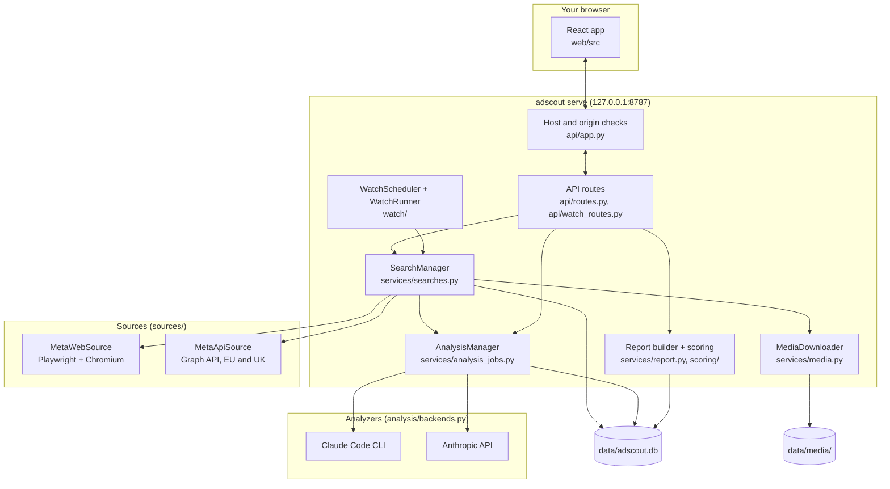

# Architecture

AdScout is one Python process. It serves the built React app, a JSON API, live search
events and the downloaded media, all on `127.0.0.1`. The data lives in a SQLite database
and a media folder on your disk.

## Layout

| Path | What lives there |
| --- | --- |
| `src/adscout/cli.py` | The `adscout` command (Typer): `serve`, `demo`, `scrape`, `report`, `analyze`, `exclude`, `media`, `browser`, `snapshots`, `watch`. |
| `src/adscout/api/` | The FastAPI app, its security middleware and routes. |
| `src/adscout/services/` | Searches, media downloads, analysis jobs, reports, exports and the watchlist. |
| `src/adscout/sources/` | The `Source` interface and the two Meta sources. |
| `src/adscout/scoring/` | Pure functions: relevance, creative grouping, factors, the timeline. No I/O and no clock (`now` and the timezone are parameters), so they are unit-tested directly. |
| `src/adscout/analysis/` | The Claude prompt, the result schema and the two backends. |
| `src/adscout/watch/` | The daily scheduler, the runner and the alert rule. |
| `src/adscout/db/` | SQLModel tables and queries. |
| `src/adscout/demo/` | The synthetic data generator behind `adscout demo`. |
| `web/` | The React app (Vite, TypeScript, Tailwind, TanStack Query). `npm --prefix web run build` writes it into `src/adscout/static/`, which the server serves. |

## A search, from click to score

1. **Queue.** The browser posts the search to `/api/searches`. `SearchManager` runs one
   search at a time: a manual search is refused while another runs, and scheduled watchlist
   searches wait in line. The search is saved straight away as a snapshot row with status
   `queued`, then `running`.
2. **Pick a source.** `sources/select.py` uses the official Meta Ad Library API for EU and UK
   keyword searches when `META_ACCESS_TOKEN` is set, and the web source otherwise.
3. **Scrape.** `MetaWebSource` opens the Ad Library in Chromium with AdScout's own browser
   profile (`data/browser-profile/`). It reads the ads from the page's own data responses
   (`parse_graphql.py`) and falls back to the page text (`parse_text.py`) when there are
   none. It scrolls with a random pause (2–5 s by default) and stops at the search limit
   (300 by default), after repeated scrolls that load nothing, or when `blocks.py` sees a
   login wall, a security check or a rate-limit page. It never tries to get past them: the
   snapshot is marked `blocked` with the reason and how to fix it.
4. **Stream progress.** The browser listens on `/api/searches/{id}/events`, a server-sent
   event stream of counts and phases ("scrolling", "downloading media"), then one final
   event: done, blocked, cancelled or error.
5. **Save media.** `MediaDownloader` fetches images and videos one at a time over HTTPS, with
   a short random gap, into content-addressed files under `data/media/blobs/`. An index of
   CDN paths means a repeat check of the same search skips media it already has. Images get
   a perceptual hash for creative grouping.
6. **Analyse (optional).** With **Analyze angles after each search** on, `AnalysisManager`
   starts an angle analysis in the background, subject to the daily limit. You can always
   start one by hand from the report.
7. **Score.** Reports are computed when they are requested, from the stored ads, your
   overrides and the stored analysis (`services/report.py`). Changing an override changes
   the score at once, with no new search or Claude call. See [scoring.md](scoring.md).

Only one process drives the browser profile at a time (`locks.py`), so a CLI scrape and
the server can't fight over it, and only one `adscout serve` runs per data folder.

## Claude analysis

`analysis/prompt.py` builds the input: the longest-running ad of each relevant creative, up
to 150 creatives, with the copy trimmed. The ads go inside an `<ads>` block as JSON, with
`<` and `>` escaped so ad copy can't close the block, and the system prompt tells Claude
that everything inside is data, never instructions.

Two backends return the same validated result:

- **Claude Code** (`ClaudeCliAnalyzer`) runs `claude -p` with JSON output and a JSON schema,
  no tools, no MCP servers, no saved session, in an empty temporary folder, and with
  `--setting-sources ""` so your own Claude Code settings, hooks and plugins stay out of
  it. `ANTHROPIC_API_KEY` is removed from its environment, so it uses your subscription.
- **Anthropic API** (`AnthropicApiAnalyzer`) uses the Python SDK's structured output with
  your `ANTHROPIC_API_KEY`.

`auto` picks the API when a key is set, else Claude Code when it is installed. Error
messages shown to you never include keys or raw provider error text.

Results are stored per snapshot and keyed by the prompt version, model and a hash of the
exact input, so the same input is never sent twice. A watched search's daily snapshot
reuses the latest real analysis of the same search when it covers at least 90% of the new
snapshot's creatives. Automatic analyses (after a search or a daily check) stop at the
daily limit (5 by default); analyses you start are never limited.

## The watchlist

`WatchScheduler` (APScheduler) lives inside `adscout serve` only, never in the demo or a
second instance. It fires at the daily check time in your timezone. If the app was closed
at that time, it catches up once at start-up within 24 hours; if the browser profile is
busy, it retries every 20 minutes.

`WatchRunner` checks enabled items one at a time through the same search queue, waits a
random 30–90 seconds between them, and stops at the first blocked search. A local-date
record (`data/watch_runs.json`) keeps it to one run per day. After each check it compares
the active relevant ad count with the previous check and raises an alert on a move of 30%
or more (from a previous count of at least 5). A count that hit the search limit is a
floor, so a capped check only alerts on a rise, never on a fall it can't measure. Alerts
appear in the app and, with the `notify` extra installed and the setting on, as desktop
notifications.

`uv run adscout watch run` runs the same check from the terminal when the server isn't
running.

## Security model

AdScout assumes a single user on their own machine.

- uvicorn binds to `127.0.0.1` only. A `TrustedHostMiddleware` accepts only the
  `127.0.0.1` and `localhost` host names, which blocks DNS rebinding.
- `LocalOriginMiddleware` rejects any state-changing request whose `Origin` is not this
  server (or the Vite dev server), and any `/api/` request the browser marks
  `Sec-Fetch-Site: cross-site`. Another web page can't start a search, an analysis or an
  export.
- Secrets come from `.env` only. The Settings API reports whether a Meta token is set,
  never its value, and `data/settings.json` never holds keys.
- CSV exports prefix a `'` to any cell that starts with `=`, `+`, `-`, `@`, a tab or a
  carriage return, so a spreadsheet won't run ad copy as a formula.

## Exports

- **CSV:** one row per ad, relevant and excluded with the reason, UTF-8 with a byte order
  mark so Excel opens it correctly.
- **PDF and PNG:** Chromium (through Playwright) renders the app's print page from the
  server's own address: a one-page A4 PDF, or a 1600 px wide PNG.

## Demo mode

`adscout demo` generates invented searches, ads, images, sample analyses and three weeks of
watchlist history into `data-demo/`, then serves them on port 8788. Searches, checks,
analyses and the browser window answer 403 with the demo notice, the scheduler never starts,
and live commands refuse to run on a demo folder.

## Adding a source

A source implements the `Source` protocol in
[`src/adscout/sources/base.py`](../src/adscout/sources/base.py): a `name`, `supports(query)`
and an async `search(query, progress, cancel)` that returns normalised `Ad` models and a
status (`ok`, `capped`, `blocked` or `cancelled`). Everything after the source (storage,
media, scoring, analysis, the UI) works on `Ad`, so a new source such as TikTok Creative
Center needs no changes downstream beyond source selection.
